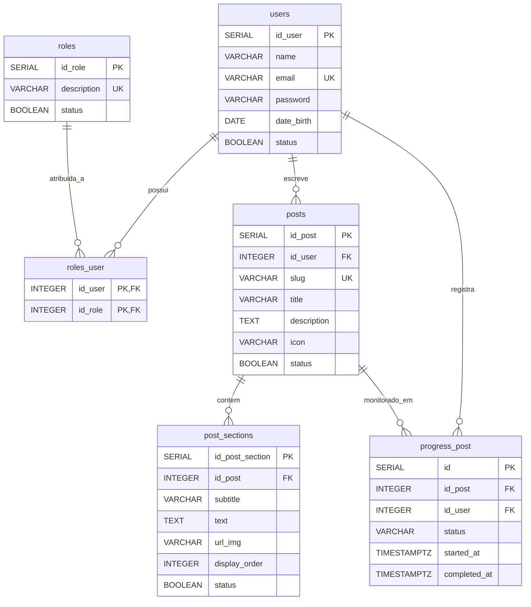

# PRD — Tech Direction

## 1. Visão Geral do Produto

O **Tech Direction** é uma plataforma educacional inclusiva voltada para o ensino de tecnologia, criada para orientar estudantes e iniciantes por meio de leituras estruturadas (posts divididos em seções), linguagem direta, referências confiáveis e foco em acessibilidade.

### 1.1 Stack Tecnológica

| Camada | Tecnologia | Observações |
| --- | --- | --- |
| **Backend** | Python 3 + Flask (`>= 3.0`) | Roteamento, sessões, upload de arquivos e renderização |
| **Banco de Dados** | PostgreSQL 16 (`psycopg[binary] >= 3.1`) | Suporte via `DATABASE_URL` no `.env` e `docker-compose.yml` |
| **Configuração** | `python-dotenv >= 1.0` | Variáveis `SECRET_KEY`, `MODO_DEV_SEM_LOGIN` e `DATABASE_URL` |
| **Frontend** | Jinja2, Tailwind CSS, Bootstrap Icons, Vanilla JS | Fonte principal *Plus Jakarta Sans* |
| **Segurança** | `werkzeug.security` | Hashing de senhas e sanitização de nomes de arquivos (`secure_filename`) |

---

## 2. Perfis de Usuário e Controle de Acesso (RBAC)

O sistema utiliza controle de acesso baseado em papéis (`roles.py` e `permissions.py`), com três perfis principais cadastrados na tabela `roles`:

| Perfil (`role`) | Permissões (`Permissions`) | Capacidades Principais |
| --- | --- | --- |
| **Estudante (`student`)** | `READ_POST` | Visualizar posts publicados (`status = TRUE`), gerenciar o próprio perfil e navegar pelas páginas institucionais. Papel padrão no autocadastro. |
| **Escritor (`writer`)** | `READ_POST`, `CREATE_POST`, `UPDATE_POST`, `DELETE_POST` | Todas as permissões de estudante + criar novos posts, listar/buscar posts em `/posts`, visualizar seus próprios rascunhos (`status = FALSE`), editar e excluir os próprios posts. |
| **Administrador (`admin`)** | `READ_POST`, `CREATE_POST`, `UPDATE_POST`, `DELETE_POST`, `UPDATE_ANY_POST`, `DELETE_ANY_POST`, `MANAGE_WRITERS` | Acesso total: visualizar rascunhos de qualquer autor, editar e excluir posts de qualquer autor, e gerenciar escritores (promover usuários e remover o papel `writer`). |

---

## 3. Requisitos Funcionais (RF)

### RF01 — Autenticação e Sessão
- **Login (`/login`):** Autenticação por e-mail e senha. Em caso de falha, retorna status HTTP `401` com mensagem genérica (`"E-mail ou senha inválidos."`) para não expor quais e-mails estão cadastrados, mantendo o e-mail preenchido no formulário.
- **Lembrar de mim:** Quando marcado, define `session.permanent = True` com duração configurada para **30 dias**.
- **Logout (`/logout`):** Limpa a sessão ativa e redireciona para `/login`.
- **Modo de Desenvolvimento (`MODO_DEV_SEM_LOGIN`):** Quando configurado como `1` no `.env`, o envio do formulário de login autentica automaticamente como `admin` (`id = 1`) sem validar credenciais.

### RF02 — Cadastro de Usuários
- **Rota (`/cadastro`):** Permite que novos usuários criem uma conta informando nome completo, e-mail, data de nascimento, senha e aceite da Política de Privacidade.
- **Regras de Validação:**
  - Todos os campos são obrigatórios.
  - O e-mail deve corresponder ao formato válido (`^[^@\s]+@[^@\s]+\.[^@\s]+$`) e ser único no sistema.
  - A data de nascimento deve ser válida e estritamente anterior à data atual (`date.today()`).
  - A senha deve ter no mínimo **8 caracteres** (`TAMANHO_MIN_SENHA = 8`).
  - O aceite dos termos da Política de Privacidade é obrigatório.
- **Atribuição padrão:** Todo usuário cadastrado recebe automaticamente o papel `student` e tem sua senha armazenada com hash (`generate_password_hash`).

### RF03 — Recuperação de Senha
- **Rota (`/recuperar-senha`):** Endpoint `POST` acionado via modal na tela de login (aceita JSON ou formulário).
- **Validação e Privacidade:** Valida o formato do e-mail (retornando HTTP `400` se inválido) e retorna mensagem padronizada (`ok: true`) independentemente de o e-mail existir ou não na base, evitando enumeração de contas.

### RF04 — Gestão de Perfil do Usuário
- **Rota (`/perfil`):** Permite ao usuário autenticado visualizar e atualizar seu nome, e-mail e data de nascimento.
- **Alteração de Senha:** Opcional; caso qualquer um dos campos de senha seja preenchido (`currentPassword`, `newPassword`, `confirmNewPassword`), o sistema exige a validação da senha atual, mínimo de 8 caracteres na nova senha e igualdade na confirmação.
- **Segurança de Papéis:** Os papéis (`roles`) não são editáveis pelo formulário de perfil (apenas administradores podem alterar permissões). Ao atualizar o nome, a sessão é atualizada imediatamente para refletir no cabeçalho.

### RF05 — Dashboard e Catálogo de Conteúdos
- **Rota (`/dashboard`):** Tela inicial da área logada com saudação personalizada pelo primeiro nome do usuário.
- **Visibilidade de Posts:**
  - Usuários comuns (`student`) visualizam apenas posts com `status = TRUE` (publicados).
  - Autores (`writer`) e administradores (`admin`) também visualizam seus rascunhos (`status = FALSE`), sendo que `admin` visualiza rascunhos de todos os autores.
- **Informações Exibidas:** Título, descrição resumida, ícone temático, nome do autor, quantidade de seções, badge de status (`PUBLICADO` ou `RASCUNHO`) e atalhos contextuais para criação/edição conforme permissões.

### RF06 — Gestão de Posts e Seções (CRUD)
- **Listagem e Busca (`/posts`):** Restrita a usuários com permissão `CREATE_POST`. Permite filtrar posts visíveis pelo título via parâmetro de query `q`.
- **Criação (`/posts/novo`):** Restrita a `CREATE_POST`. Campos:
  - Título (obrigatório) e descrição (opcional).
  - Ícone selecionado a partir da lista `POST_ICONS` (13 ícones Bootstrap Icons, padrão `bi-code-slash`).
  - Status (`Publicado` ou `Rascunho`).
  - Seções dinâmicas (`1..N`): cada seção possui subtítulo (opcional), texto (obrigatório para ser persistida), ordem de exibição (`display_order`) e imagem opcional (`png`, `jpg`, `jpeg`, `webp`, `gif`, `svg`) salva em `static/uploads/posts/` com prefixo UUID.
  - **Geração de Slug:** Gera automaticamente um `slug` único a partir do título (com sufixo numérico incremental em caso de colisão).
- **Leitura (`/post` e `/post/<slug>`):**
  - `/post` sem slug redireciona para o primeiro post visível ou para `/posts` / `/dashboard` se não houver posts.
  - `/post/<slug>` exibe o conteúdo completo do post e suas seções ordenadas. Retorna HTTP `404` se o post não existir ou for um rascunho sem permissão de visualização.
  - **Interações no Cliente (`view-trilha.js`):** Botão de marcador/favorito (`btnBookmark`) e cópia de blocos de código (`data-copy-code`).
- **Edição (`/post/<slug>/editar`):** Permitida apenas para `admin` (`UPDATE_ANY_POST`) ou para o próprio autor (`UPDATE_POST`). Atualiza título, descrição, ícone, status e substitui as seções mantendo imagens anteriores válidas quando nenhuma nova imagem for enviada. O `slug` e o autor original são preservados.
- **Exclusão (`/post/<slug>/excluir`):** Permitida apenas para `admin` (`DELETE_ANY_POST`) ou para o próprio autor (`DELETE_POST`). Remove o post e, por cascata no banco (`ON DELETE CASCADE`), suas seções e registros de progresso.

### RF07 — Gestão de Escritores (Administração)
- **Listagem (`/escritores`):** Restrita a `MANAGE_WRITERS` (`admin`). Lista todos os usuários ativos com papel `writer` em ordem alfabética e exibe a contagem de posts de cada autor.
- **Promoção (`/escritores/novo`):** Lista usuários ativos que ainda não possuem papel `writer` nem `admin` e permite atribuir o papel `writer`.
- **Remoção (`/escritores/<id_usuario>/remover`):** Remove o papel `writer` do usuário. Caso o usuário fique sem nenhum papel associado, o sistema atribui automaticamente o papel `student`.

### RF08 — Páginas Institucionais Públicas
- **Quem Somos (`/quem-somos`):** Apresenta o propósito, pilares e valores da plataforma; acessível para visitantes não autenticados e usuários logados (adaptando cabeçalho e barra lateral).
- **Política de Privacidade (`/politica-de-privacidade`):** Exibe os termos de privacidade da plataforma, referenciada também no fluxo de cadastro.

---

## 4. Requisitos Não Funcionais (RNF)

### RNF01 — Segurança e Integridade
- **Armazenamento de Senhas:** Todas as senhas são armazenadas exclusivamente em formato hash via `werkzeug.security.generate_password_hash` e verificadas com `check_password_hash`.
- **Proteção de Rotas:** Uso dos decorators `@login_obrigatorio` (redireciona para `/login` se não autenticado) e `@permissao_obrigatoria(permissao)` (retorna HTTP `403` quando falta permissão).
- **Sanitização de Uploads:** Imagens enviadas em seções passam por `secure_filename`, validação de extensão permitida (`ALLOWED_IMAGE_EXTENSIONS`) e renomeação com `uuid.uuid4().hex`. Caminhos de imagens existentes só são reaproveitados se iniciarem com `/static/uploads/posts/`.
- **Resiliência a Falhas de Banco:** Exceções `BancoIndisponivel` são capturadas globalmente pelo handler do Flask, exibindo mensagem amigável ao usuário e retornando HTTP `503` sem expor detalhes internos.
- **Usuários Inativos:** Usuários com `status = FALSE` na tabela `users` são filtrados nas consultas de autenticação e listagem.

### RNF02 — Acessibilidade e Design System
- Conformidade com o `DESIGN_SYSTEM.md`:
  - **Contraste:** Mínimo de **4,5:1** para texto corrido e **3:1** para textos grandes, componentes e estados de foco; cores não transmitem estado isoladamente (sempre acompanhadas de ícone ou rótulo).
  - **Navegação e Semântica:** Suporte completo a teclado (`focus-visible`), leitores de tela (atributos `aria-label`, `aria-labelledby`, `aria-pressed`, `aria-current`) e marcação semântica HTML5 (`header`, `main`, `nav`, `article`, `section`).
  - **Tipografia e Layout:** Família *Plus Jakarta Sans* com tamanho raiz `16px`, escala em `rem`, unidade base de `4px` e container máximo de `76rem`.

### RNF03 — Portabilidade, Persistência e Operação
- **Modo Dual de Dados:** A aplicação opera com PostgreSQL quando `DATABASE_URL` está configurada no `.env` e possui fallback automático em memória (`usuarios` e `POSTS` no `app.py`) para testes rápidos sem banco.
- **Migrations Idempotentes:** Scripts SQL em `migrations/` (`001` a `008`) utilizam `IF NOT EXISTS` e `ON CONFLICT`, executados em transação única via `python banco.py migrar`.
- **Diagnóstico e Bootstrap:**
  - `python banco.py verificar` testa a conexão e valida a existência das 6 tabelas esperadas, roles e usuários.
  - `python criar_admin.py "Nome" email@dominio.com Senha` cria o primeiro administrador no banco.
- **Ambiente Local:** Disponibilidade de `docker-compose.yml` com PostgreSQL 16 e healthcheck configurado.

---

## 5. Modelo de Dados

O esquema relacional no PostgreSQL é composto por 6 tabelas definidas nas migrations `001` a `008`:

